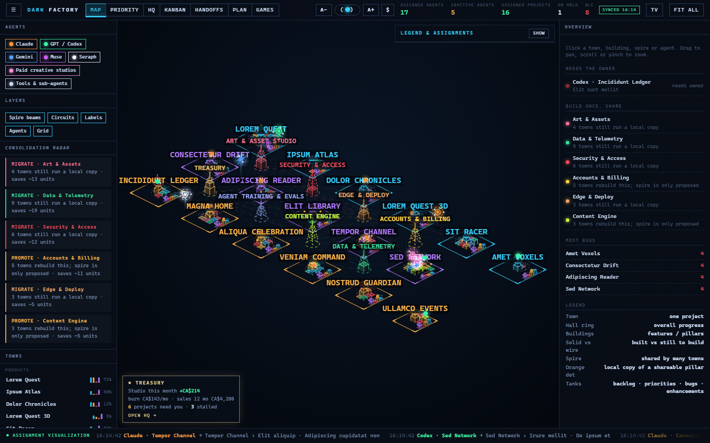

# DarkFactory_public

How To Build a Dark Factory.

A Dark Factory is a project dashboard where AI agents do the work and a person watches, steers and approves. It is built from plain-text backlogs, a script that reads them, and a static page that draws the result, with a login in front and humans in charge of the risky parts.

**Start here: [DarkFactory_Guide.md](DarkFactory_Guide.md)**, a step-by-step guide for someone starting from scratch (rules, backlog format, registry, sync script, dashboard, Cloudflare login, scheduling, agent boundaries, a weekend plan and starter prompts).

**See what it looks like: [From an empty plane to a living city](blog/from-empty-plane-to-living-city.md)**, a tour of the dashboard with screenshots (lorem ipsum demo data, nothing private).

