# From an empty plane to a living city: our Dark Factory dashboard

*Every project, every AI agent, every blocker, on one map you can zoom around. Here is what it looks like and what it can do.*

> All screenshots below use **lorem ipsum demo data**. The layout and the code are the real dashboard; the project names, tasks, numbers and people are made up. Nothing private is shown.

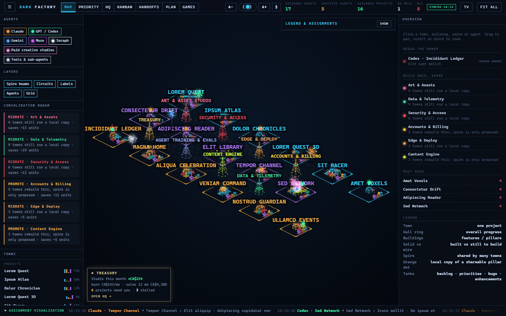

## The idea

If you run more than a couple of projects with AI helping, you lose track fast. Which agent is on what? What is blocked, and by whom? What did you promise yourself last month? A **Dark Factory** is a factory that runs with the lights off: agents do the work, and you watch, steer and approve. The dashboard is the window into it.

We wanted that window to be something you *enjoy* opening, so every project is a **town** on a living isometric map. This post tours what it can do. If you want to build your own, the companion [step-by-step guide](../DarkFactory_Guide.md) walks through it.

## 1. See all your projects at once

- **Towns** are projects. The ring around a town shows overall progress.
- **Buildings** are features. Solid means built, wireframe means still to build.
- **Tanks** beside a town show backlog, priorities, bugs and enhancements.
- **Spires** are shared systems that many towns need, like security, deployment or art. A spire is built once and serves everyone.
- **Drones** are your agents. They fly to the town they are working on, and the footer ticker tells you what they just picked up.

Click a town and the right-hand panel opens its charter (why it exists, the next milestone, the biggest risk), its numbers and every building.

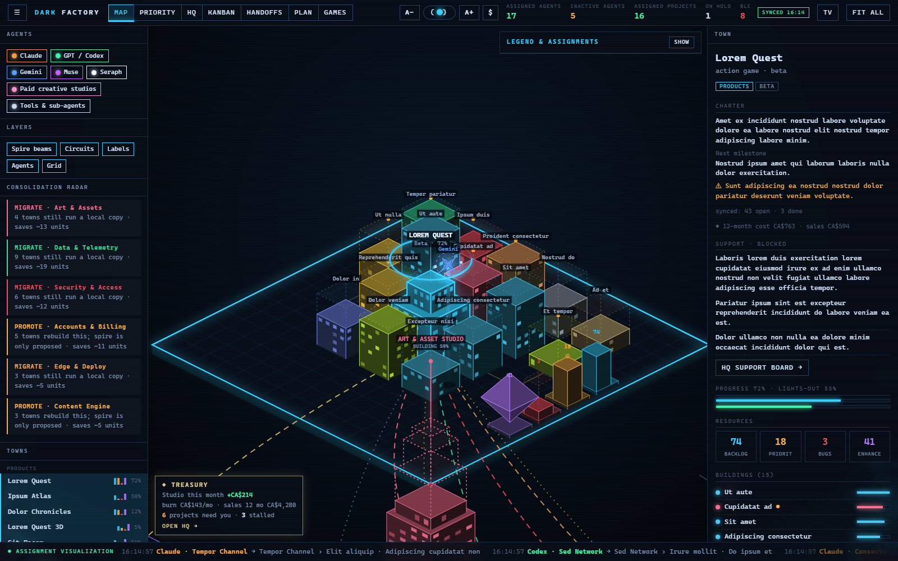

A **consolidation radar** on the left watches for duplicated effort. When several towns each keep their own copy of something shareable, it suggests promoting it to a spire and tells you roughly how much work that would save.

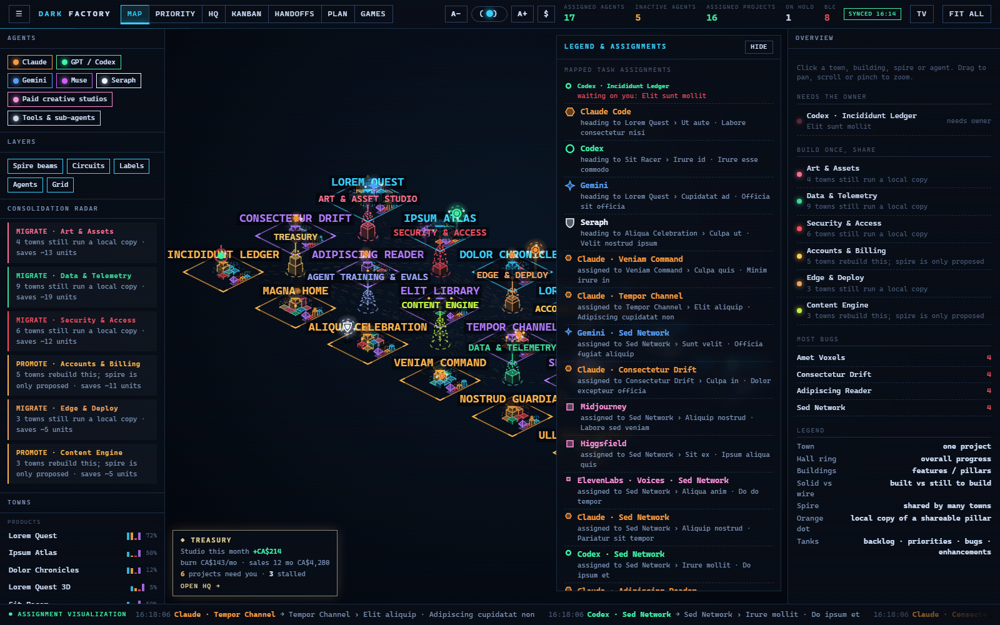

## 2. Priorities: what needs *you* right now

The map is lovely, but the **Priority** view is where the day starts. It answers three questions:

- **Needs you:** the decisions only a human can make, ranked by impact.
- **Blocked:** the P0 and P1 tasks that are stuck, and how many other tasks each one holds up.
- **Decisions only you can make:** the owner-only gates (money, legal, access, publishing).

It also lets you queue a job for a more powerful machine, so a phone becomes a remote control for the workhorses.

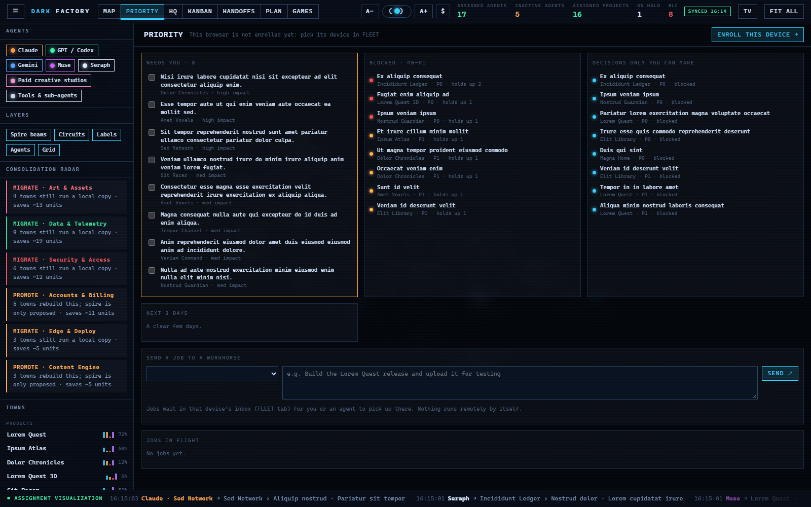

## 3. Blockers and progress, honestly

The **Kanban** is not just columns. Every task knows what it depends on, so the strip across the top shows the **critical path**: who is holding up the most work. Filter by priority, type, project, or "blocked only".

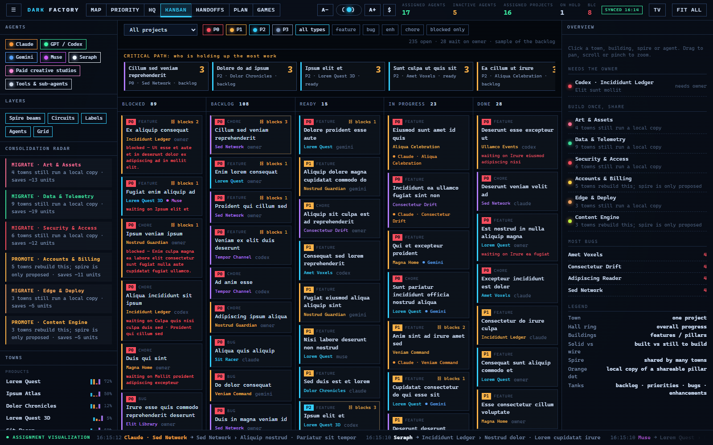

The rule that keeps this honest: the dashboard never invents progress. Task status comes from plain-text backlog files that agents and humans edit, and "done" means something was run and passed. You see blockers appear, get cleared, and the city grow as a result.

## 4. Watch an empty plane become a city

This is our favourite part. A new Dark Factory starts as an empty plane. Add your first project and a lone town appears with a couple of half-built buildings and one agent.

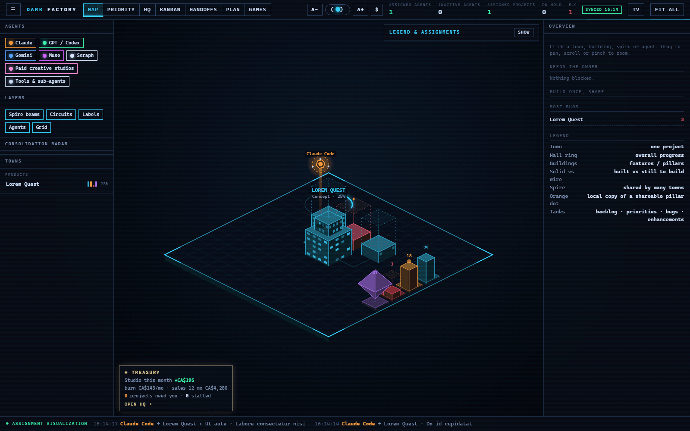

A few weeks later you have several towns, your first shared spires going up, and a second agent.

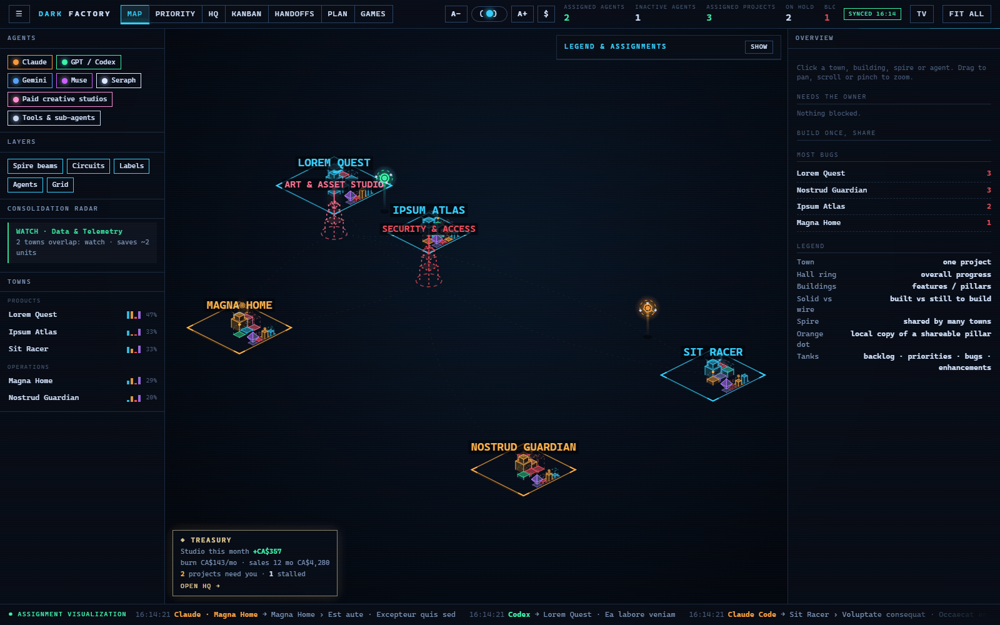

A quarter in, the map is dense: towns across products, creator work and operations, spires linking them, a team of agents moving between them.

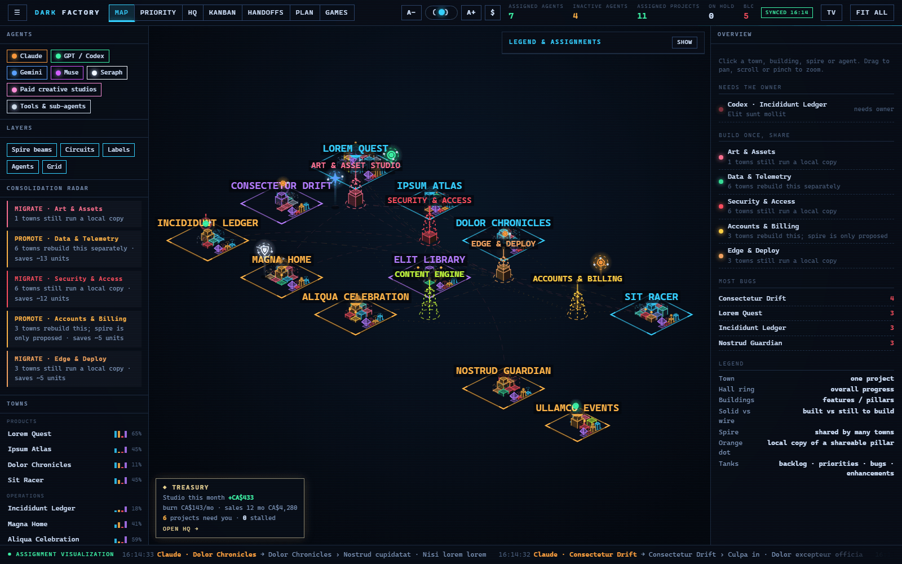

Scrolling back through that sequence is oddly motivating. You can *see* what you have built.

## 5. Plan, track and design

**Plan** is a calendar built for a working life: day, three days, week, month, quarter and year. It shows paydays, bills, birthdays, trips, quarterly goals and suggested focus blocks, so the project work sits next to the real life it has to fit into.

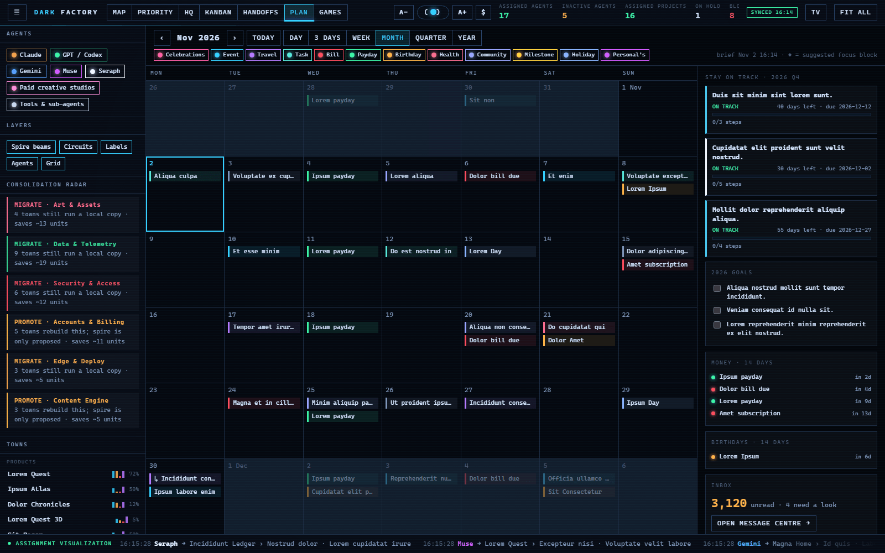

**Games** is a design and economics dashboard for products you plan to sell. It lists each game's pillars, features and components, then asks the honest question: *is it worth my time?* You move sliders (players, conversion, spend per player, chance it ships, hours still to put in) and get a plain verdict such as **Invest** or **Timebox**.

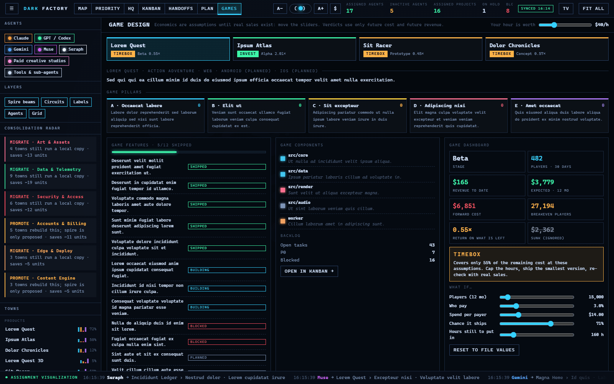

## 6. HQ: money and portfolio support

**HQ** brings the money onto the same screen: monthly profit and loss, where costs go, recurring subscriptions, cost per project and what feeds the numbers. Above it sits your list of next unblockers, each tied to its source, so "what should I do first?" always has an answer.

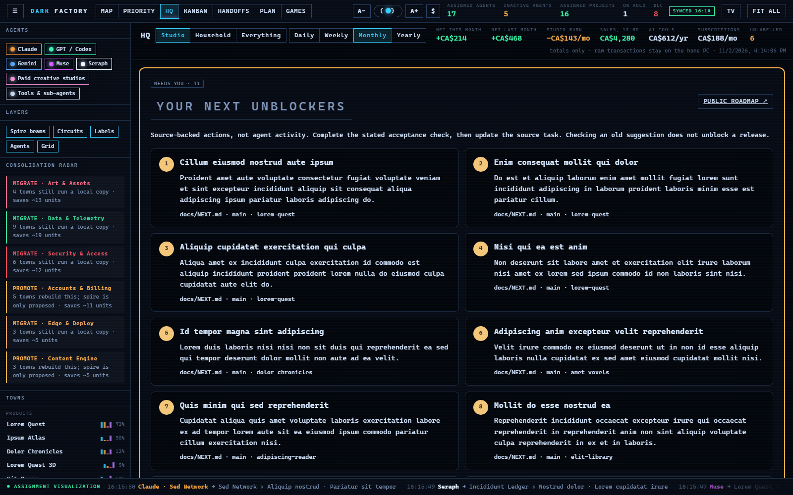

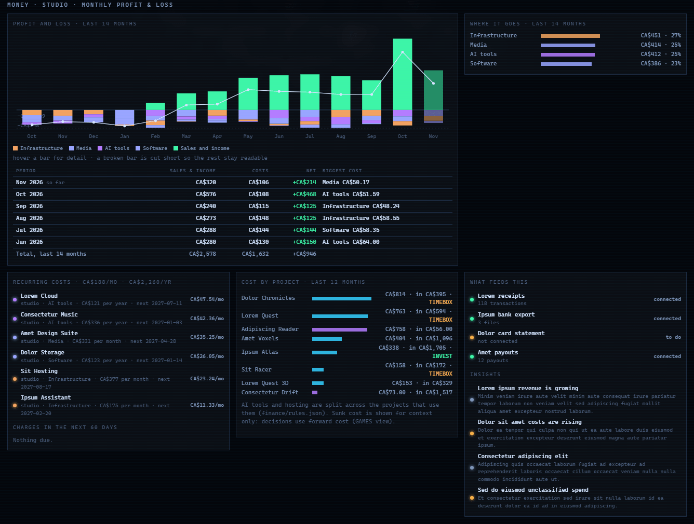

## Why it works

- **Backlogs are the source of truth.** A script reads them and builds the dashboard. The page is read-only for work, so it can never run something by accident.
- **It is static and cheap.** A small web page and one tiny API, deployed on a free hosting plan and gated behind a login.
- **Humans stay in charge of the risky parts.** Passwords, payments, DNS, access and publishing stay with a person. Agents plan first, then build, and a human reviews.
- **It is honest.** If a project is at 30%, the map shows 30%.

## Where it goes next: your own HQ

Once the core works, the same pattern connects to almost anything that can be turned into a file or an API:

- **Your inbox and calendar** for a daily brief and a cleanup plan.
- **Analytics and telemetry** from the products you ship, next to their backlog.
- **Finance exports** for a live profit and loss that never leaves your machine.
- **Security scans** of your sites, domains and code, reported as findings you can act on.
- **A fleet view** of your own computers: disk, load and what each one is good for.
- **Creative pipelines**, where image, video, voice and music tools are agents like any other.
- **Your home and devices**, with lights, locks and cameras as the next towns on the map.

That is the direction we are heading: not another dashboard, but a personal **mission control**, a JARVIS-style HQ where your projects, your agents, your money and your day all live in one place and you stay in the pilot's seat.

## Build your own

Everything above grows from the same few ideas: plain-text backlogs, a script that reads them, a static page that draws the result, a login in front, and humans in charge of the risky parts.

**Start here:** [DarkFactory_Guide.md](../DarkFactory_Guide.md). It takes you from nothing to a deployed, scheduled dashboard in a weekend, with prompts you can paste into your AI assistant.

*Built with Claude, Codex and Gemini.*
